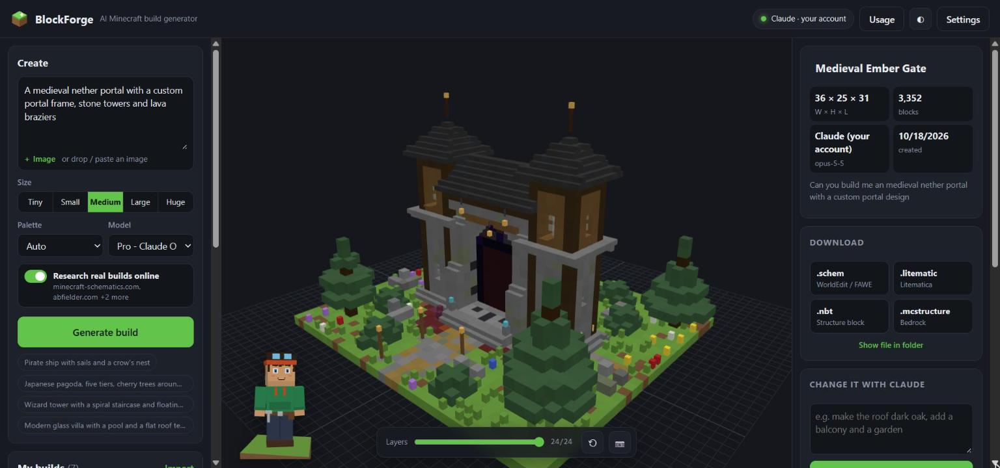
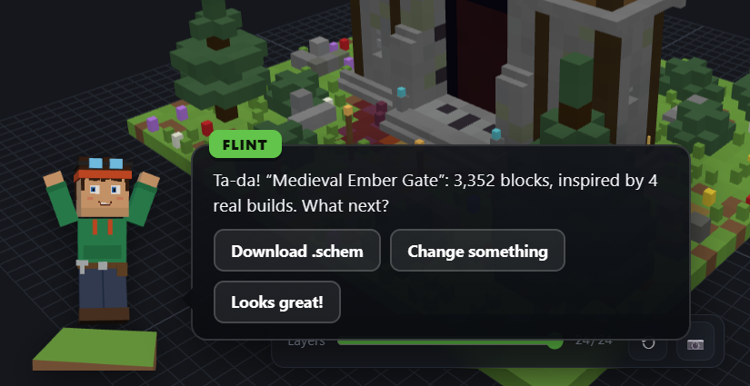
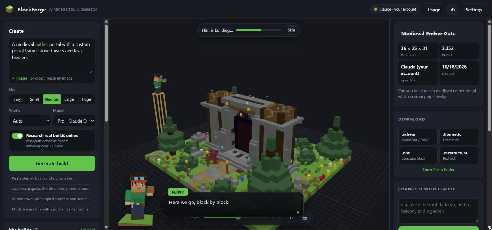
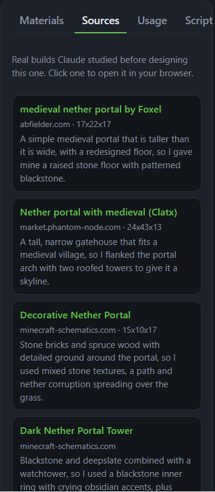
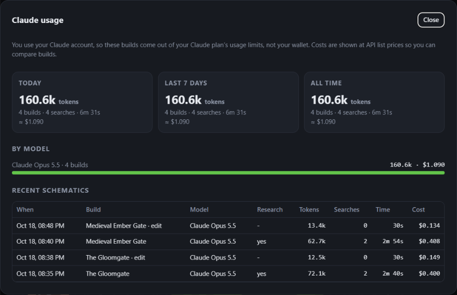
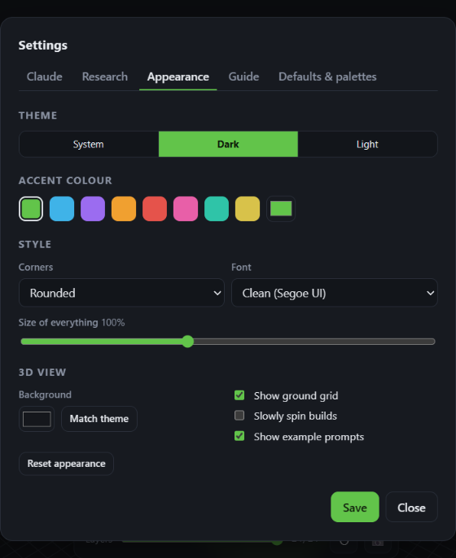
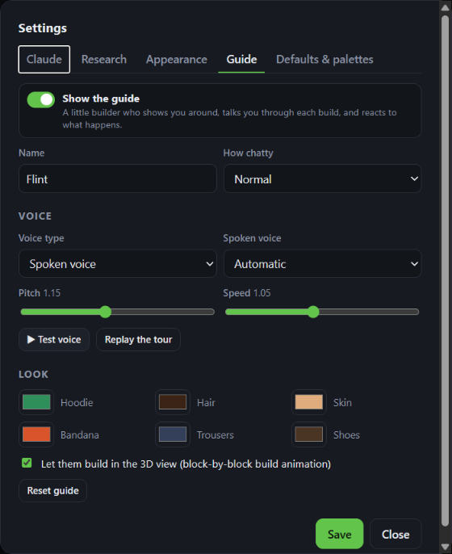

<p align="center">
  
</p>

<h1 align="center">BlockForge</h1>

<p align="center"><b>Describe a Minecraft build, or drop in a picture, and Claude designs it for you.</b><br>
3D preview, block-by-block build animation, and free downloads for WorldEdit, Litematica, structure blocks and Bedrock.</p>

<p align="center">
  <a href="https://github.com/Ryn-labs/BlockForge/releases/latest"><b>⬇ Download the Windows installer</b></a>
</p>



BlockForge is a Windows desktop app for making Minecraft schematics with AI. Type something like
*"a medieval nether portal with stone towers and lava braziers"*. Claude looks at how real builders
have made it on popular schematic sites, designs an original build, and BlockForge shows it to you in 3D.
Then you download it in the format you need. There's no paywall and no per-download fee.

## Features

- **Text or image to build.** Describe anything, or attach a picture to rebuild it in 3D.
- **Use the AI you like.** Claude (your Claude account or an API key) is the default and gives the best builds.
  You can also use OpenAI, Google Gemini, OpenRouter, DeepSeek, xAI Grok, Mistral or Groq with your own API key,
  any OpenAI-compatible service, or a free local model with **LM Studio** or **Ollama**.
- **Working redstone.** Doors, farms, sorters, clocks and contraptions get a redstone design guide, helpers that
  set repeater, comparator, piston and observer directions correctly, automatic wiring for dust and rails (pasted
  schematics don't update, so BlockForge connects them for you, along with fences, panes and walls), and a checker
  that catches floating parts and missing power. The AI then fixes whatever the checker finds. It switches on by
  itself when your prompt sounds like redstone.
- **Researches real builds first.** Before designing, Claude searches
  [minecraft-schematics.com](https://www.minecraft-schematics.com/), [abfielder.com](https://abfielder.com/),
  [PhantomMarket](https://market.phantom-node.com/) and [MineSchematic](https://mineschematic.com/). It studies
  the closest builds' size, palette and details, then designs its own. The Sources tab lists every build it
  looked at, with links. You can edit the site list in Settings.
- **Meet Flint, your guide.** A blocky story-mode-style builder with a cartoon outline, an expressive face
  (14 expressions), emote bubbles and **about 40 animations**: wave, nod, salute, hammer, mine, read plans,
  search, bright idea, victory, disco, robot, moonwalk, backflip, flex, laugh, love, scared, sleep and more. He
  gives you a tour, talks you through each build as it happens, builds the schematic in front of you layer by
  layer, naps when you leave him alone, and wakes up grumpy if you poke him. Try every animation in
  **Settings → Guide**.
- **Make Flint yours.** Choose his hair, hat (hard hat, wizard hat, crown...), outfit, eye colour, goggles,
  backpack, scarf, cape and every colour, plus his name and how chatty he is.
- **Pick his voice.** The built-in natural **HD voice** works offline and free. Download more free voices (Bryce,
  Norman, John, Kristin, Linda, Kathleen, Sam, Alba) with one click, or use a Windows voice, game blips, or
  silent. Pitch and speed are adjustable, and his mouth follows the sound.
- **ElevenLabs voices.** Got an [ElevenLabs](https://elevenlabs.io) account? Paste your API key in
  **Settings → Guide**, load your voices (including cloned ones), pick a model and Flint speaks with it. A
  **Save my credits** switch keeps ElevenLabs for the big moments and uses the free voice for quick chatter,
  repeated lines are cached so they never cost credits twice, and your remaining credits are shown. If your
  credits run out or the key fails, Flint falls back to his offline voice by himself.
- **Change it with Claude.** For example, "make the roof dark oak and add a balcony". You get a new version,
  and the original is kept.
- **Free downloads in every format:** `.schem` (WorldEdit / FAWE), `.litematic` (Litematica), `.nbt` (structure
  block) and `.mcstructure` (Bedrock, beta). There's always a **⬇ .schem** button under the 3D view, and every
  build in the gallery has a download button, so you can download any build again whenever you like.
- **One-click updates.** When a new release is on GitHub, an **Update** button appears (and Flint lets you know).
  BlockForge downloads the new installer, checks its SHA-256 checksum, installs it and reopens itself.
- **Claude usage tracking.** See the tokens, web searches, time and estimated cost for each build, plus
  today / 7-day / all-time totals.
- **Make it yours.** Theme, accent colour, corner style, font, UI size, 3D background, your own block palettes,
  and Flint's name, voice and outfit.
- **See what every block is.** Hover any block in the 3D view to see its real name (Stone Bricks, Spruce Planks...),
  its settings, its position and how many the build uses. Click it, or a row in the Materials list, to show only
  that block type, with everything else faded, so you can see exactly where it goes.
- **Also included:** a layers slider to see inside, a material list in stacks, editable build scripts, a gallery,
  and import of existing `.schem` / `.litematic` / `.nbt` files.

| Flint talks you through it | ...then builds it in front of you |
|---|---|
|  |  |

| Real builds Claude studied | Claude usage per build |
|---|---|
|  |  |

| Restyle the app | Customise Flint |
|---|---|
|  |  |

## Install

1. Download **`BlockForge-<version>.msi`** from the [latest release](https://github.com/Ryn-labs/BlockForge/releases/latest) and run it.
   BlockForge installs to `C:\Program Files\BlockForge` and adds Desktop and Start-menu shortcuts.
   The installer isn't code-signed yet, so Windows SmartScreen may warn you. Click **More info → Run anyway**.
2. Open **BlockForge**, go to **Settings → Claude**, and choose how it talks to Claude:
   - **My Claude account (Claude Code).** This uses the [Claude Code](https://claude.com/claude-code) program
     on your PC with your Claude subscription, so no API key is needed. Click **Sign in to Claude** if it says
     you're not signed in. If you have the Claude desktop app, BlockForge finds the Claude Code that comes with it.
   - **Anthropic API key.** Pay-as-you-go from [console.anthropic.com](https://console.anthropic.com/). The key
     is stored only on your PC.
3. Describe a build and click **Generate build**. A researched build usually takes 2–5 minutes.

Requirements: Windows 10/11 (64-bit) with the Microsoft Edge WebView2 runtime (Windows 11 already has it),
about 300 MB of disk space,
and an internet connection to generate builds. Your builds and settings are saved in `%LOCALAPPDATA%\BlockForge`.
Uninstalling the app keeps them.

## Models

| In the app | Model | Good for |
|---|---|---|
| Pro | Claude Opus 5.5 | The most detail. This is the default. |
| Standard | Claude Sonnet 5.5 | Faster builds |
| Quick | Claude Haiku 5.5 | Quick tests and small props |

### Other AIs

Open **Settings → AI**, pick a provider, paste your API key (there's a "Get a key" link) and click **Load models**.
The model list comes straight from the provider, so new models show up without a BlockForge update.

| Provider | What you need |
|---|---|
| OpenAI, Google Gemini, OpenRouter, DeepSeek, xAI Grok, Mistral, Groq | Your own API key from that provider |
| Custom | The API address (and key, if needed) of any OpenAI-compatible service |
| LM Studio / Ollama | The app running on your PC with a model loaded and its local server started. Free, but slower and simpler builds |

Online research uses Claude's web search, so it's only available with Claude. Other AIs still get the redstone
guide, the redstone checker and automatic error fixing. Usage shows their token counts. OpenRouter also reports
real cost, while other providers bill your account directly.

## Build from a Claude Code chat

Claude Code can make builds straight into BlockForge. In the cloned folder, create a file named `.mcp.json`
containing:

```json
{
  "mcpServers": {
    "blockforge": { "command": "python", "args": ["blockforge/mcp_server.py"] }
  }
}
```

Then open a Claude Code chat in that folder, approve the **blockforge** server, and ask for something like
*"make me a wizard tower in BlockForge"*.
Claude writes the build, researches the same schematic sites, and the result appears in the app's gallery.

## How it works

Claude doesn't output blocks directly. It writes a short Python build script using BlockForge's building toolkit
(`fill`, `walls`, `gable_roof`, `sphere`, `cylinder`, `mirror`, `tree`, `noise` and more), shown in the Script tab.
The script runs in a locked-down sandbox: no file or network access, and only a few safe imports. If it fails,
the error goes back to Claude to fix (up to 2 tries). Then BlockForge writes the schematic files itself.
That keeps builds editable and lets you tweak the script by hand and run it again.

```
blockforge/
  server.py       local web server for the app window (127.0.0.1:8765)
  engine.py       talks to Claude (Claude Code or the API), research, usage tracking
  prompts.py      the builder prompt and research instructions
  buildkit.py     the building toolkit build scripts use
  sandbox.py      checks and runs build scripts in a separate process
  exporters.py    .schem / .litematic / .nbt / .mcstructure writers and importers
  mcp_server.py   Claude Code chat link (MCP over stdio)
  app_main.py     desktop entry point (pywebview window)
  static/         the UI: three.js viewer, Flint (character.js, guide.js)
installer/        PyInstaller spec + WiX installer source
```

## Run or build from source

```bat
pip install -r requirements.txt
python installer\get_voice.py
python blockforge\launcher.pyw
```

`get_voice.py` downloads Flint's HD voice (the Piper engine and the "Joe" voice, about 85 MB) into
`blockforge/voice/`. It isn't stored in the repo because the files are too big.

To build the installer you also need the [WiX Toolset](https://wixtoolset.org/) v5 and its Util extension:

```bat
dotnet tool install --global wix --version 5.0.2
wix extension add -g WixToolset.Util.wixext/5.0.2
installer\build_msi.bat
```

To make a release: bump `VERSION` in `blockforge/version.py`, run `installer\build_msi.bat`, then publish a GitHub
release tagged `v<version>` with `BlockForge-<version>.msi` attached. Installed copies will offer the update
automatically. Installing a newer MSI replaces the old version, and the installer never restarts your PC.

## Notes

- Online research uses reference builds for inspiration only. Claude designs an original build and doesn't copy
  anyone's schematic. Credit for the reference builds goes to their creators, and the Sources tab links to them.
- The Bedrock `.mcstructure` export is a best effort. Some block states may differ on Bedrock.
- BlockForge is not an official Minecraft product and is not approved by or associated with Mojang or Microsoft.
- The 3D viewer uses [three.js](https://threejs.org/) (MIT licence).
- Flint's HD voice uses [Piper](https://github.com/rhasspy/piper) (MIT), [eSpeak NG](https://github.com/espeak-ng/espeak-ng)
  (GPL-3.0) and the [en_US "Joe" voice](https://huggingface.co/rhasspy/piper-voices/tree/v1.0.0/en/en_US/joe/medium)
  (CC0 dataset). See [blockforge/voice/LICENSES.md](blockforge/voice/LICENSES.md).
